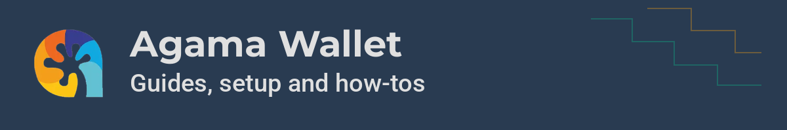

# Agama Wallet guide index

Every guide published in this repository, one line each. The [Agama Wallet page](https://github.com/agama-wallet/agama-desktop-wallet) carries the download and the shorter selection.

## Install, versions and assets

| Guide | What it covers |
|---|---|
| [Agama Wallet Download: Version 0.3.7 and How to Get It](https://github.com/agama-wallet/agama-wallet/blob/main/download-and-install.md) | where the files are, which version is current, and how to check one |
| [Agama Wallet: What It Is, and Which Agama You Are Looking At](https://github.com/agama-wallet/agama-wallet/blob/main/which-version-you-have.md) | the two products behind one name, and how to tell which you installed |
| [Is Agama Wallet Safe? What Can and Cannot Be Verified](https://github.com/agama-wallet/agama-wallet/blob/main/is-it-safe-to-use.md) | what the licence, the source and the release values can and cannot prove |
| [Which Assets Agama Wallet Supports](https://github.com/agama-wallet/agama-wallet/blob/main/supported-coins.md) | the assets the wallet lists, and the token that depends on another chain |
| [Native Mode vs SPV Mode in Agama Wallet](https://github.com/agama-wallet/agama-wallet/blob/main/native-versus-spv-mode.md) | local validation against remote servers, and what each costs |
| [Agama Wallet on Android and iOS](https://github.com/agama-wallet/agama-wallet/blob/main/android-and-ios.md) | why the release is desktop only, and what a phone build would need |
| [Updating Agama Wallet: What to Expect](https://github.com/agama-wallet/agama-wallet/blob/main/how-updates-work.md) | installing over the old build, and what a version number does not tell you |
| [Finding Your Receiving Address in Agama Wallet](https://github.com/agama-wallet/agama-wallet/blob/main/find-your-receiving-address.md) | where the address is, why it rotates, and which chain it belongs to |

## Recovery, fees and problems

| Guide | What it covers |
|---|---|
| [Restoring an Agama Wallet: Seed, Passphrase and Wallet File](https://github.com/agama-wallet/agama-wallet/blob/main/restore-from-seed-phrase.md) | the restore flow, and why a phrase is the only route back |
| [Why a Seed Phrase Fails to Restore a Wallet](https://github.com/agama-wallet/agama-wallet/blob/main/why-a-seed-phrase-fails.md) | word order, derivation rules and scan ranges, in that order |
| [Agama Wallet Backup: What wallet.dat Covers](https://github.com/agama-wallet/agama-wallet/blob/main/backup-what-dat-covers.md) | what the wallet file holds, and what it misses |
| [Agama Wallet Shows Zero Balance: Causes and Checks](https://github.com/agama-wallet/agama-wallet/blob/main/zero-balance-after-restore.md) | four causes in the order worth checking, cheapest first |
| [Moving KMD Out of an Old Agama Wallet](https://github.com/agama-wallet/agama-wallet/blob/main/move-kmd-out-safely.md) | restoring keys in working software, then sending to a wallet you control |
| [Fees in Agama Wallet: Swap Fees and Network Fees](https://github.com/agama-wallet/agama-wallet/blob/main/swap-and-network-fees.md) | no platform fee, several network fees, and a spread that shows nowhere |
| [Agama Wallet vs MetaMask: Different Tools, Different Jobs](https://github.com/agama-wallet/agama-wallet/blob/main/compared-with-metamask.md) | one is output-based and multi-chain, the other is account-based and Ethereum-first |

## History and ecosystem

| Guide | What it covers |
|---|---|
| [Is Agama Wallet Discontinued? Two Products, One Name](https://github.com/agama-wallet/agama-wallet/blob/main/two-products-one-name.md) | what Komodo discontinued in 2019, and what runs under the name now |
| [The 2019 Agama Wallet Vulnerability, Explained](https://github.com/agama-wallet/agama-wallet/blob/main/the-2019-supply-chain-incident.md) | how a dependency reached the wallet, and what was claimed afterwards |
| [AtomicDEX: What the Decentralised Exchange Was](https://github.com/agama-wallet/agama-wallet/blob/main/atomicdex-explained.md) | the exchange Komodo named as the replacement, and why it is not this wallet |
| [Komodo Wallet: What It Is and How KMD Works](https://github.com/agama-wallet/agama-wallet/blob/main/komodo-and-kmd.md) | the chain line from Agama to Komodo Wallet, and where KMD sits now |
| [KMD Coin: What Komodo's Native Asset Does](https://github.com/agama-wallet/agama-wallet/blob/main/what-kmd-does.md) | what the native asset pays for, and what its supply does |
| [Verus Wallet: What VRSC Is and Where It Runs](https://github.com/agama-wallet/agama-wallet/blob/main/verus-and-vrsc.md) | a separate chain, a separate build, and no connection to the 2019 incident |
| [What Is Komodo? The Chain Behind KMD](https://github.com/agama-wallet/agama-wallet/blob/main/komodo-in-one-page.md) | the chain, its notarisation and its asset chains, without the history |
| [BarterDEX: The Exchange Agama Shipped With](https://github.com/agama-wallet/agama-wallet/blob/main/barterdex-protocol.md) | the swap protocol the wallet shipped with, and the pair between it and the trade |
| [Komodo dPoW: Notarising One Chain to Another](https://github.com/agama-wallet/agama-wallet/blob/main/delayed-proof-of-work.md) | notarising one chain onto another, and what that does not protect |

## About

Published alongside Agama Wallet, a self-custody multi-asset wallet for the Komodo ecosystem.

## License

MIT
